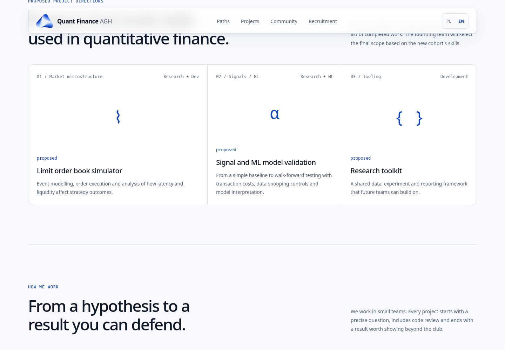

# Brand identity — Phase 1 and Phase 1.1 review

Baseline: `agent/react-signal-desk`, commit `182b467`. Review branch: `design/brand-redesign-phase-1`.

## Design decisions

- Light, editorial composition with a strong institutional research statement, comfortable paragraph lengths, and generous spacing. System sans-serif avoids extra font requests; monospace is limited to technical metadata.
- Official QFC symbol in the header and footer, with PNG and ICO favicons. The supplied transparent `qfc-symbol.png` was cropped to its existing artwork and resized with Lanczos resampling, preserving the artwork and gradients. The header asset is approximately 25 KB instead of 475 KB; no substitute logo was drawn. PNG favicons retain the original colors.
- Blue tokens derive from the logo: deep blue `#1245B9`, cobalt `#3477E8`, soft blue `#8FB5F5`, ice blue `#DCE9FC`; off-white `#F7F9FC` and ink `#101827`. Shared spacing, border, radius, and shadow tokens live in `src/styles.css`.
- Glass is limited to the floating navigation surface and language control. Solid white is the default material. An explicit feature query enables backdrop blur; reduced-transparency and increased-contrast preferences restore opaque navigation.
- PL/EN hero copy introduces research and engineering, with working anchors to projects and recruitment. The research/development selector is retained as a quiet supporting panel. Arbitrary numeric skill strengths and animated bars were removed; topics are descriptive.
- Lower sections retain their components, copy, anchor destinations, and grid structure. Changes there align colors, type scale, borders, and spacing with the new foundations. Recruitment remains a preparation preview rather than an active application form.

## Verification

- `npm ci`: passed; dependency manifest and lockfile unchanged.
- `npm run lint`: passed.
- `npm run build`: passed (TypeScript and Vite).
- `git diff --check`: passed.
- Chromium browser checks in both languages at **375, 768, 1440, and 1920 CSS px**: no document or visible-element horizontal overflow; logo loaded; no JavaScript runtime errors.
- Track tabs: click, ArrowRight, Home, selection state, panel association, and roving tab focus checked.
- Mobile menu: opening focuses the first link; Escape closes and restores trigger focus; project navigation closes the menu and reaches the intended anchor.
- Language: switch updates the document language, copy, and active indicator; preference survives reload.
- Recruitment dialog: opens with close-button focus, traps Tab, closes with Escape, and restores trigger focus.
- Skip link reaches the main content; visible keyboard focus styles are present.
- Reduced motion: browser emulation confirms transitions are disabled. Reduced transparency: browser emulation confirms a solid white header and no backdrop blur.
- Text token contrast on the lightest blue panel surface: body **5.82:1**, metadata **4.66:1**, blue accent **7.45:1**. White on the primary button: **8.15:1**.
- Unsupported-backdrop behavior reviewed in CSS: opaque defaults precede the `@supports` enhancement. Browser checks used Chromium; Firefox/Safari were not independently tested.

`npm ci` reports two pre-existing high-severity audit findings in development dependencies (`brace-expansion` and `source-map-js`). `npm audit --omit=dev` reports zero vulnerabilities. Dependency upgrades are outside this visual phase.

## Phase 1.1 refinement

The approved composition is retained. Desktop headlines separate the research statement from its engineering clause, with a consistent 52px maximum size. The panel uses natural content heights instead of empty reserved space. Small text has a 12px floor; skill labels are 13px. Logo prominence increases slightly on desktop while the mobile header stays compact.

| Detail | Phase 1 | Phase 1.1 |
| --- | --- | --- |
| Desktop hero top spacing | 208px | 176px |
| Headline-to-paragraph gap | 30px | 24px |
| Paragraph-to-actions gap | 34px | 28px |
| Hero caption top spacing | 80px | 48px |
| Description / skill-list reserved height | 92px / 60px | Natural content height |
| Panel metadata / skill labels | 9.6px / 10.88px | 12px / 13px |
| Header white opacity / backdrop blur | 82% / 22px | 74% / 16px |
| Desktop logo width | 44px | 48px |
| Secondary CTA | Join Our Community / Dołącz do społeczności | How to Join / Jak dołączyć |
| First-time language | Polish | English; explicit saved PL/EN preferences retained |

The navigation uses a quieter layered shadow, a controlled translucent border, and a white inner edge. The backdrop enhancement follows responsive rules so mobile navigation receives the same material. Solid defaults and preference overrides remain in place.

Phase 1.1 checks: lint, TypeScript/Vite build, Chromium PL/EN at 375/768/1440/1920px, no horizontal overflow or runtime errors, tab keyboard controls, mobile menu focus and navigation, recruitment dialog, skip link, and reduced-motion/transparency support. Browser text audit found no visible text below 12px. Fresh visits, invalid stored JSON, explicit saved preferences, and language switching when storage is unavailable were checked. Project descriptions and dependency files are unchanged.

## Screenshots

Updated Phase 1.1 captures from the running Vite site at 1440 × 1000 and 375 × 1000, showing the header and hero. The mobile page continues below the viewport.

| Language | Desktop | Mobile |
| --- | --- | --- |
| Polish | [Desktop](screenshots/pl-desktop.png) | [Mobile](screenshots/pl-mobile.png) |
| English | [Desktop](screenshots/en-desktop.png) | [Mobile](screenshots/en-mobile.png) |

| Comparison | Phase 1 | Phase 1.1 |
| --- | --- | --- |
| English desktop | [Before](screenshots/phase-1/en-desktop.png) | [After](screenshots/en-desktop.png) |
| English mobile | [Before](screenshots/phase-1/en-mobile.png) | [After](screenshots/en-mobile.png) |
| Polish desktop | [Before](screenshots/phase-1/pl-desktop.png) | [After](screenshots/pl-desktop.png) |
| Polish mobile | [Before](screenshots/phase-1/pl-mobile.png) | [After](screenshots/pl-mobile.png) |

The before images are unchanged screenshots from commit `a026927`.

[Scrolled desktop navigation over project content](screenshots/en-desktop-scrolled.png).

Phase 2 remains pending review.
