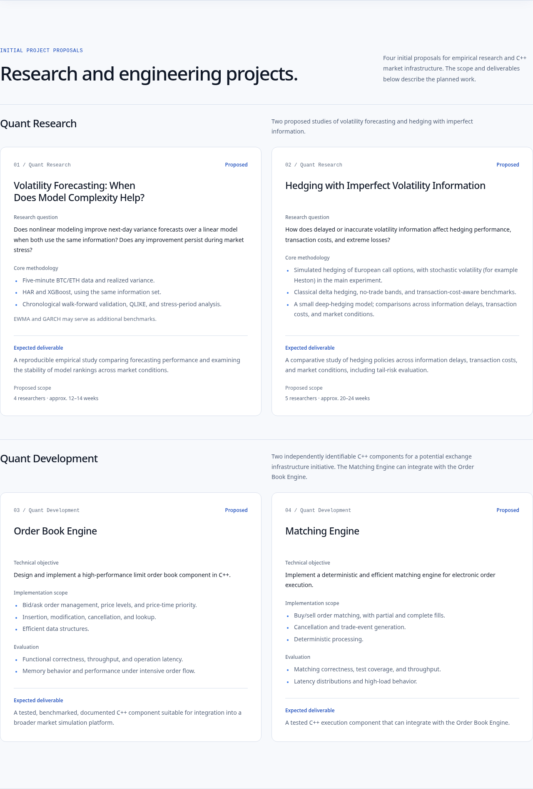

# Phase 2 — Research and Development projects

Baseline: approved Phase 1.1 commit `c3babb7`. Branch: `codex/research-development-projects-phase-2`. The draft PR targets `design/brand-redesign-phase-1`, keeping this work separate from PR #1.

## Design review

Two clearly labelled groups each contain two proposal cards: Quant Research and Quant Development. Desktop uses two columns with equal-height cards within each group; mobile uses one reading column. White surfaces, blue/slate text, restrained borders, and the approved type scale maintain the institutional identity.

All questions or objectives, core methods or implementation scope, expected deliverables, and proposal statuses remain visible. Development cards also show evaluation criteria. Static definition lists and short method lists provide readable structure without another interaction layer. Project titles are keyboard-accessible permalinks, with stable anchors and clearance below the floating navbar.

The Development introduction explains the potential exchange-infrastructure relationship while each component retains its own title, scope, evaluation, and deliverable. Research staffing and durations appear only under **Proposed scope**, with approximate durations. All four statuses remain **Proposed** (Polish: **Propozycja**).

No illustrative charts, fabricated results, repositories, team members, publications, partners, or deadlines were added. Project recruitment is not linked to the general membership preview. The navbar, hero, logo, language preference behavior, and remaining section content are preserved.

## Content model and accuracy

`src/content.ts` uses typed project groups and distinct Research/Development records. Research records hold questions, methods, optional benchmarks, and proposed researcher/week metadata. Development records hold objectives, implementation scope, and evaluation criteria; their type has no researcher or schedule field. Status and expected deliverables are explicit in each record.

| Proposal | Details retained from the brief |
| --- | --- |
| Volatility Forecasting | Five-minute BTC/ETH, realized variance, HAR/XGBoost with the same information, chronological walk-forward, QLIKE, stress-period analysis; optional EWMA/GARCH; reproducible study and ranking stability; proposed 4 researchers, approximately 12–14 weeks |
| Imperfect Volatility Hedging | European calls, simulated hedging, stochastic volatility such as Heston in the main experiment, delta hedging, no-trade bands, cost-aware benchmarks, small deep-hedging model; information delays, costs, market conditions and tail risk; proposed 5 researchers, approximately 20–24 weeks |
| Order Book Engine | C++ limit order book; bid/ask, price levels, price-time priority, insert/modify/cancel/lookup, efficient structures; correctness, throughput, operation latency, memory and intensive flow; tested, benchmarked, documented component as the expected outcome |
| Matching Engine | C++ electronic execution; buy/sell matching, partial/full fills, cancellation, trade events, determinism; correctness, coverage, throughput, latency distributions and high load; tested component integrating with the Order Book Engine as the expected outcome |

Both language versions share IDs, order, proposal status, research scopes, and the same scientific/technical content. All non-project PL/EN content was compared directly with the approved Phase 1.1 model and remains identical. No dependencies were added.

## Verification

- `npm run lint`: passed.
- `npm run build`: passed, including the TypeScript build.
- `git diff --check`: passed.
- Chromium at 375, 768, 1440 and 1920px in both languages: four cards, two correct groups, matching titles/statuses, core methods, deliverables, research scopes and absence of Development staffing/schedules checked.
- Two columns on desktop and one column at tablet/mobile widths; equal card heights within desktop pairs; no horizontal document or visible-element overflow.
- All four project permalinks tested with keyboard focus and Enter. Fragment navigation focuses the corresponding article and leaves it below the floating navbar. Desktop and mobile navigation to `#projects` also focus the section with navbar clearance.
- No JavaScript runtime errors. Full-page screenshots were taken after scrolling through all sections and confirming no reveal content remained hidden.
- Structured-data checks verify matching PL/EN IDs, groups, status and scope numbers, optional EWMA/GARCH, and Heston in the main experiment.
- Non-project content compared against Phase 1.1 and unchanged; no dependencies, routing framework, backend, or CMS added.

Browser validation used Chromium; Firefox and Safari were not independently tested. No publication or merge is part of this phase.

## Screenshots

Full-page captures include the complete page with all reveal sections visible, at 1440 × 1000 and 375 × 1000 browser viewports. Full image height follows page content.

| Language | Desktop full page | Mobile full page | Projects detail |
| --- | --- | --- | --- |
| English | [Desktop](screenshots/phase-2/en-desktop-full.png) | [Mobile](screenshots/phase-2/en-mobile-full.png) | [Projects](screenshots/phase-2/en-projects.png) |
| Polish | [Desktop](screenshots/phase-2/pl-desktop-full.png) | [Mobile](screenshots/phase-2/pl-mobile-full.png) | [Projects](screenshots/phase-2/pl-projects.png) |

